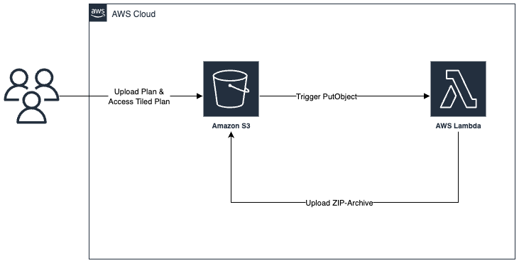

# serverless-zoom-tiler

## Ziel des Projekts
Das Projekt "serverless-zoom-tiler" realisiert eine automatisierte, event-gesteuerte Pipeline zur Verarbeitung von in einen S3 Bucket hochgeladenen Grundrissen. Ziel ist es, Bilder in „Image Tiles“ (Bildkacheln) zu zerlegen, um performante Zoom-Funktionen zu ermöglichen. Der Prozess ist vollständig serverless konzipiert, um eine kosteneffiziente und skalierbare Verarbeitung ohne dauerhafte Serverinstanzen zu gewährleisten und somit Infrastrukturverwaltung zu minimieren.

## Projektstruktur
```bash
.
├── architecture/                   # Terraform-Skripte
│   ├── iam.tf                      # Nutzer, Berechtigungen & Rollen
│   ├── lambda.tf                   # Lambda
│   ├── provider.tf                 # Cloud-Provider Einstellungen
│   ├── s3.tf                       # Bucket 
├── assets/                         # Testdateien
├── docker-compose.yml              # LocalStack Setup
├── Makefile                        # Deploy- und Dev-Skripte
├── README.md                       
├── scripts/                        # Utility-Skripte für den Betrieb
├── tiler/                          # Service-Logik
│   ├── cmd/                        # Applikationseinstiegspunkt
│   │   └── main.go                 # Lambda-Handler
│   └── internal/                   # Business-Logik
```

## Verwendete Cloud-Services
Management der Cloud-Infrastruktur sowie Deploy-Logik werden reproduzierbar über Terraform abgewickelt.

| Service | Funktion | Aufgabe |
| :--- | :--- | :--- |
| **Amazon S3** | Persistenter Speicher | Nimmt Grundrisse entgegen Rohdaten (`uploads/`); löst `ObjectCreated` aus nimmt Ergebnis-ZIP entgegen (`processed/`). |
| **AWS Lambda** | Serverless Compute | Bereitstellung der Serverless-Umgebung; Ausführung des Go-Handlers durch S3-Trigger |
| **AWS IAM** | Zugriffskontrolle | Verwaltung von Nutzern und Policies für Dev-User und Lambda/S3 |

## Architektur


## Erwartetes Ergebnis / Testfall
Die erfolgreiche Verarbeitung eines Grundrisses in ein ZIP-Archiv welches erfolgreich in den S3 Bucket hochgeladen ist (`processed/`) gilt als erwartetes Ergebnis:
1. Input: Eine Bilddatei wird in das Verzeichnis `uploads/` des Buckets `cc2526-tiling-storage` hochgeladen
2. Trigger: S3 erkennt den Upload und löst die Lambda-Funktion S3TilingHandler aus
3. Verarbeitung: Die Lambda-Funktion lädt das Bild, zerlegt es in Kacheln und bündelt diese in einer ZIP-Datei
4. Output: Im Verzeichnis `processed/` erscheint automatisch eine ZIP-Datei mit der fertigen Kachelstruktur
5. Validierung: Die Log-Ausgaben bestätigen den erfolgreichen Upload in den S3 Bucket 